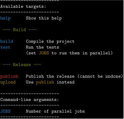

# makefile-doc

[![CI][ci-badge]][ci]

Generate `make help` from comments in your Makefile.

`makefile-doc.awk` is a single awk script with no dependencies other than `awk`. It reads your
Makefiles and prints the targets and variables you documented, with sections, colors, and optional
export to HTML and LaTeX.

```Makefile
help: ## Show this help
	@awk -f makefile-doc.awk $(MAKEFILE_LIST)

## Number of parallel jobs
JOBS := 4

##@
##@ --- Build ---
##@

## Compile the project
build:

## Run the tests
## (set `JOBS` to run them in parallel)
test: build

##@
##@ --- Release ---
##@

##! Publish the release (cannot be undone)
publish: test

##% Use `publish` instead
upload:
```

Running `make` prints:



See [this blog post](https://drdv.github.io/blog/202511-makefile-doc) for another example.

The script started as a more elaborate version of [this
one-liner](https://gist.github.com/prwhite/8168133).

**Contents:** [Install](#install) ·
[Writing docs](#writing-docs) ·
[Options](#options) ·
[Substitutions](#substitutions) ·
[Export to HTML and LaTeX](#export-to-html-and-latex) ·
[Limitations](#limitations) ·
[Development](#development)

## Install

### Download on first use

Define the first target of your `Makefile` (or set `.DEFAULT_GOAL := help`) as:

```Makefile
help: VER := v2.1
help: URL := https://github.com/drdv/makefile-doc/releases/download/$(VER)/makefile-doc.awk
help: SCR := $(HOME)/.local/share/makefile-doc/makefile-doc-$(VER).awk
help: ## Show this help
	@test -f $(SCR) || { mkdir -p $(dir $(SCR)) && \
		curl -fsSL -o $(SCR).tmp $(URL) && mv $(SCR).tmp $(SCR); }
	@awk -f $(SCR) $(MAKEFILE_LIST)
```

The first `make help` downloads version `VER` of the script into `~/.local/share/makefile-doc`, and
later runs reuse it. To upgrade, change `VER`: the new version is downloaded next to the old one.

### Manual installation

Download `makefile-doc.awk` from the [releases](https://github.com/drdv/makefile-doc/releases),
place it in a directory of your choice and make this the first target of your `Makefile`:

```Makefile
help: ## Show this help
	@awk -f /path/to/makefile-doc.awk $(MAKEFILE_LIST)
```

If your awk supports `AWKPATH` (e.g., gawk), you can use it to locate the script without its full
path.

### Compatibility

makefile-doc works with GNU Make 3.81 or later and with all the major awks (gawk, mawk, the one true
awk, busybox awk, wak and goawk), in versions spanning 30 years: from mawk 1.3.3 (1996) and gawk
3.1.7 to the latest releases. The tested versions are listed as platforms in
[test/containers.toml](test/containers.toml). It runs on Linux, macOS and Windows (with the awk of
Git for Windows, e.g., in Git Bash, or a native gawk); all three are tested in CI.

## Writing docs

makefile-doc reads comments that start with one of four tokens. A doc is attached to a target or a
variable, which we call an _anchor_. A section is displayed above the anchors that follow it.

| Token | Meaning                          | Default color |
|-------|----------------------------------|---------------|
| `##`  | doc of a target or a variable    | blue          |
| `##!` | doc of an anchor that needs care | red           |
| `##%` | doc of a deprecated anchor       | yellow        |
| `##@` | section title                    | green         |

```Makefile
## doc of a variable the user might want to set on the command line
MY_VARIABLE = 42

## doc above a target, line 1
## line 2
target1:

target2: ## inline doc
```

### Docs of targets and variables

A doc goes either **above** its anchor, on one or more lines, or **inline**, after it[^inline]. If
an anchor has both, the doc above is used.

Some lines can appear between a doc and its anchor: blank lines, comments, conditionals (`ifeq` ...
`endif`) and the [special
targets](https://www.gnu.org/software/make/manual/html_node/Special-Targets.html) of GNU Make such
as `.PHONY: target` or `.ONESHELL:` (other targets whose names start with a dot, e.g., `.ENV:`, are
regular targets). Any other line discards the doc: `include`, `vpath`, `endef`, an `export`
without an assignment, a function call such as `$(info ...)`, or a comment banner (a line of three
or more `#` only, e.g., `###`). An `unexport` line discards the doc too, with or without names
after it (it is a directive, not an assignment). A line such as `### text` is not a banner: it is a
doc whose text starts with `#`.

The remaining details:

- In a multi-line doc, only the first line needs the `##!` or `##%` token; the other lines can start
  with `##`.
- Deprecated anchors (`##%`) can be hidden with `-v DEPRECATED=0`.
- As in GNU Make, a doc or a comment that ends with a backslash continues on the next line,
  whatever that line is: the two are joined with a space. For example, a target on the next
  line becomes part of the doc (Make does not see the target either).
- On a target line, a `##` after an inline recipe (`target: ; command ## text`) is part of the
  recipe, not a doc.
- Docs and sections can be indented with spaces or tabs. In a rule, a line that starts with the
  recipe prefix (a tab by default) is a recipe line, not a doc. As in GNU Make, this includes a
  line that holds only the prefix (an empty recipe line): it discards the doc above it.
- A multi-line variable (`define NAME` ... `endef`) is documented above its `define` line, not
  inline.

### Sections

- A section is one or more lines that start with `##@`; an empty `##@` line displays a blank line,
  e.g., to separate the section from the anchors around it. Every line of a multi-line section needs
  the token; blank lines between them are ignored.
- A section is displayed above the next displayed anchor: hidden anchors (variables with `VARS=0`,
  deprecated anchors with `DEPRECATED=0`) are skipped. A section with no displayed anchor after it
  is not displayed.

### Special kinds of targets

- Several targets in one rule (`t1 t2: deps`) are displayed as one anchor, `t1 t2`.
- [Double-colon](https://www.gnu.org/software/make/manual/html_node/Double_002dColon.html)
  targets are displayed as `target-name~index`, and each rule can have its own doc. The index
  counts only the rules that have a doc.
- [Grouped](https://www.gnu.org/software/make/manual/html_node/Multiple-Targets.html)
  targets are displayed with a `&` at the end, e.g., `t1 t2 t3&` (also in double-colon
  form).
- A target-specific assignment (`t: V := 1`) documents its target, `t`, like a rule.
- Inside a `define` block, documented targets and variables are displayed too (e.g., in canned
  recipes).

See `test/fixtures/Makefile.*` for many more examples.

## Options

Options are passed to `awk` with `-v OPTION=value`:

```Makefile
help: ## Show this help
	@awk -v DEPRECATED=0 -v PADDING=. -f makefile-doc.awk $(MAKEFILE_LIST)
```

| Option            | Values (default)                        | Meaning                                   |
|-------------------|-----------------------------------------|-------------------------------------------|
| `VARS`            | `0`, (`1`)                              | show documented variables                 |
| `DEPRECATED`      | `0`, (`1`)                              | show deprecated anchors                   |
| `PADDING`         | one character (space)                   | fills the gap between anchors and docs    |
| `OFFSET`          | `0`, `1`, (`2`), ...                    | number of spaces between anchors and docs |
| `COLOR`           | `0`, (`1`)                              | `0` turns off all colors                  |
| `OUTPUT_FORMAT`   | (`ANSI`), `HTML`, `LATEX`               | format of the output                      |
| `EXPORT_THEME`    | see [export](#export-to-html-and-latex) | colors of the HTML and LaTeX output       |
| `SUB`, `DSUB`     | see [Substitutions](#substitutions)     | substitutions in names and docs           |
| `RECIPEPREFIX`    | one character (tab)                     | the recipe prefix at the start            |

`COLOR` defaults to `0` when the environment variable `NO_COLOR` is set to a non-empty value (see
[no-color.org](https://no-color.org)). An invalid value is an error: all the invalid options are
reported, nothing else is printed and the exit status is 1. An option given as an operand, without
`-v` (e.g., `awk -f makefile-doc.awk VARS=0 Makefile`), is an error too: awk would set it only
after the options are checked and used. As in GNU Make, only the first character of `RECIPEPREFIX`
is used.

The assignments to `.RECIPEPREFIX` in the Makefiles are followed: the prefix changes for the lines
after them. `RECIPEPREFIX` is the prefix at the start, so it is needed only when the prefix is set
where makefile-doc does not see it (on the command line of `make`, or in a file that is not passed
to the script). A value that is not written on the line (`:=` with a reference, as in
`.RECIPEPREFIX := $(P)`, `!=`, or a `define`) is not followed: the prefix keeps its previous value.
With `=`, the value is used as written, as GNU Make does.

Without a Makefile, the script reads one from stdin, e.g., `cat Makefile | awk -f makefile-doc.awk`
(in messages, stdin is named `-`). If stdin is empty, e.g., `awk -f makefile-doc.awk < /dev/null`
or Ctrl-D in a terminal, the script prints the options with their current values and exits with
status 1.

### Colors

The colors are options too, e.g., `-v COLOR_SECTION=35` for magenta sections:

| Option             | Default       | Used for                            |
|--------------------|---------------|-------------------------------------|
| `COLOR_DEFAULT`    | `34` (blue)   | anchors whose docs start with `##`  |
| `COLOR_ATTENTION`  | `31` (red)    | anchors whose docs start with `##!` |
| `COLOR_DEPRECATED` | `33` (yellow) | anchors whose docs start with `##%` |
| `COLOR_SECTION`    | `32` (green)  | sections                            |
| `COLOR_BACKTICKS`  | `33`          | text in backticks in docs           |

A color is the parameter of an [ANSI escape
code](https://en.wikipedia.org/wiki/ANSI_escape_code#Select_Graphic_Rendition_parameters), e.g., the
`34` in `\033[34m` for blue. The supported parameters are `0`, `1`, `3`, `4`, `9`, `30`-`37`,
`40`-`47`, `90`-`97` and `100`-`107`.

## Substitutions

makefile-doc does not expand Make variables: a target written `$(OPEN_NOTES):` is displayed as
`$(OPEN_NOTES)`, and a doc that mentions `$(DEPS)` shows `$(DEPS)`. Substitutions, passed on the
command line, fill this gap: `SUB` changes how an anchor is displayed (a new name and a list of
values), and `DSUB` replaces text inside docs and section titles and, optionally, in the names of
anchors.

### `SUB`: rename an anchor and list its values

The format of `SUB` is `NAME:[[LABEL]:][VALUES]`: the anchor `NAME` is displayed as `LABEL` (or
unchanged without a label), and the space-separated `VALUES` are added to its doc. Several
substitutions are separated by `;`, and a name can appear only once. For example, running `make`
with

```Makefile
NOTES := my-budget trip-info misc
OPEN_NOTES := $(addprefix open-,$(NOTES))

help: VFLAG := -v SUB='$$(OPEN_NOTES):open-:$(NOTES)'
help: ## Show this help
	@awk $(VFLAG) -f makefile-doc.awk $(MAKEFILE_LIST)

## Notes:
$(OPEN_NOTES):
```

prints

```
-----------------------
Available targets:
-----------------------
help    Show this help
open-   Notes:
        my-budget
        trip-info
        misc
-----------------------
```

Variables can be substituted in the same way. `NAME` is the name of the anchor as it is displayed
without substitutions, e.g., `t~1` for the first documented rule of a double-colon target `t`, or
`t1 t2&` for grouped targets.

Only the first two colons are separators, so values can contain colons (e.g., URLs). With
two or more colons, the text between the first two is always the label:

| `SUB`       | Displayed name | Values |
|-------------|----------------|--------|
| `t:a b`     | `t`            | `a b`  |
| `t:new:a b` | `new`          | `a b`  |
| `t::/a:b`   | `t`            | `/a:b` |
| `t:/a:b`    | `/a`           | `b`    |

An empty label does not rename the anchor: use it to give a value with a colon (third
row).

### `SUB` parameters

A substitution can start with parameters that control how the values are displayed:
`<p1:v1,...>NAME:[[LABEL]:][VALUES]`.

| Parameter | Meaning                                                    | Default |
|-----------|------------------------------------------------------------|---------|
| `L`       | `0`: values start on the line of the doc, `1`: on the next | `1`     |
| `M`       | `0`: all values on one line, `1`: one value per line       | `1`     |
| `N`       | maximum number of values to display (`-1`: no limit)       | `-1`    |
| `S`       | separator added after each value but the last              | none    |
| `P`       | prefix added to each value                                 | none    |
| `I`       | initial string, e.g., `{`                                  | none    |
| `T`       | termination string, e.g., `}`                              | none    |

For example, `-v SUB='<L:0,M:0,I:{,T:},S:\\,>t:a b c'` displays `t   doc {a, b, c}`.

- In a parameter, only the first colon is a separator: `S::` sets the separator to a
  colon and `P:x:y` the prefix to `x:y`.
- A comma in a parameter value is written `\,`; on the command line the backslash has to
  be doubled (`\\,`).
- A parameter value cannot contain `>`, which ends the parameters.
- A parameter can be given only once.
- A `NAME` that starts with `<...>` would be read as parameters: put parameters before it, empty
  ones if needed, e.g., `<><t>:label:`.

See `test/integration/sub-*.test` for more examples.

### `DSUB`: replace text in docs and names

`DSUB` replaces text in the docs and section titles. Its format is `NAME:VALUE`; everything after
the first colon is the value, so it can contain colons. For example, with `-v
DSUB='$$(DEPS):$(DEPS)'`, the target

```Makefile
DEPS := x y
## Prerequisites: $(DEPS)
t: $(DEPS)
```

is documented as

```
t   Prerequisites: x y
```

Several substitutions are separated by `;` and applied in the order given, and a name can appear
only once. Values cannot contain newlines.

A substitution can start with parameters, `<p1:v1,...>NAME:VALUE`, that say where the
text is replaced:

| Parameter | Meaning                                                           | Default |
|-----------|-------------------------------------------------------------------|---------|
| `A`       | `1`: also replace in the displayed names of targets and variables | `0`     |
| `D`       | `0`: do not replace in the docs and section titles                | `1`     |

As with `SUB`, a parameter can be given only once.

For example, with `-v DSUB='<A:1>$$(OUT_DIR):$(OUT_DIR)'`,

```Makefile
OUT_DIR := out
## Write the report (after $(OUT_DIR)/data)
$(OUT_DIR)/report:
```

is documented as

```
out/report   Write the report (after out/data)
```

and with `<A:1,D:0>` only the name is changed. As with `SUB`, a `NAME` that starts with `<...>`
needs parameters before it, empty ones if needed, e.g., `-v DSUB='<><b>:B'` replaces `<b>`.

`DSUB` changes only the docs, the section titles and, optionally, the names of anchors that `SUB`
has not renamed: it never changes `SUB` labels and values.

## Export to HTML and LaTeX

`-v OUTPUT_FORMAT=html` and `-v OUTPUT_FORMAT=latex` (the value is case-insensitive) print the
documentation as HTML or LaTeX. The HTML output is a fragment to paste into a page: a `<style>`
element followed by a `<div class="makefile-doc">`, and the names of all its classes start with
`makefile-doc`. The LaTeX output is a complete document, cropped to the text, to compile with, e.g.,
`tectonic`.

The ANSI colors are mapped to the
[Solarized](https://github.com/altercation/solarized?tab=readme-ov-file#the-values) dark palette by
default, and `EXPORT_THEME` changes this mapping. Its format is
`ANSI_COLOR_PARAMETER:HEX_COLOR[,...]`, with the hex color written without `#`. The tokens `FG` and
`BG` set the foreground and the background; without them, the uncolored text and the background
follow the page in the HTML output, and are black on white in the LaTeX output. Colors that are not
listed keep their default. For example, to use the
[Dracula](https://github.com/dracula/dracula-theme?tab=readme-ov-file#color-palette) theme:

```Makefile
DRACULA := 30:21222c,31:ff5555,32:50fa7b,33:f1fa8c,34:bd93f9,35:ff79c6,36:8be9fd,37:f8f8f2
DRACULA := $(DRACULA),90:6272a4,91:ff6e6e,92:69ff94,93:ffffa5,94:d6acff,95:ff92df,96:a4ffff
DRACULA := $(DRACULA),97:ffffff,BG:000000,FG:AAAAAA

help: ## Show this help
	@awk \
		-v EXPORT_THEME=$(DRACULA) \
		-v OUTPUT_FORMAT=html \
		-f makefile-doc.awk $(MAKEFILE_LIST)
```

`EXPORT_THEME` has no effect on the output in the terminal.

## Limitations

makefile-doc reads the Makefiles line by line, following the syntax of GNU Make (see
[misc/docs/parser-model.tex](misc/docs/parser-model.tex)), but it does not evaluate them:

- **Conditionals are not evaluated.** The lines of all the branches of an `ifeq` ... `endif` are
  read in order, so an anchor documented in several branches has its docs redefined (with a
  warning).
- **Included files are not followed.** An `include` line does not read the file: pass the files
  to the script (e.g., `$(MAKEFILE_LIST)`), which reads them one after another.
- **References are not expanded.** Names are displayed as written, e.g., `$(OBJS):` as `$(OBJS)`
  and `$(PREFIX)_FLAGS := -O2` as `$(PREFIX)_FLAGS`, and an assignment to `.RECIPEPREFIX` whose
  value is not written on the line is not followed (see [Options](#options)). To display a name
  differently, use [`SUB`](#sub-rename-an-anchor-and-list-its-values) for one anchor, e.g., `-v
  SUB='$$(PREFIX)_FLAGS:MY_FLAGS:'`, or [`DSUB`](#dsub-replace-text-in-docs-and-names) with `A:1`
  for every name at once, e.g., `-v DSUB='<A:1>$$(PREFIX):MY'`.

Escaped characters in target names are displayed as written: `foo\ bar:` is shown as `foo\ bar`,
which is how the target is invoked (`make foo\ bar`), and `foo\#bar:` as `foo\#bar`.

## Development

The tests are run by pytest through [uv](https://docs.astral.sh/uv), which is the only thing to
install: `uv run` sets up Python and the test dependencies on first use. `make help` lists the
targets, e.g., `make check` lints the code and runs all the tests with the system's awk.

See [test/README.md](test/README.md) for how the tests work, how to write new ones, and how known
bugs are reported and fixed, and [tools/README.md](tools/README.md) for how a release is made.

## License

[Apache-2.0](LICENSE)

[^inline]: Inline docs on variables need care, because in GNU Make
    ["trailing space characters are not stripped from variable
    values"](https://www.gnu.org/software/make/manual/html_node/Simple-Assignment.html):
    the spaces before the `##` become part of the value.

[ci-badge]: https://github.com/drdv/makefile-doc/actions/workflows/main.yml/badge.svg
[ci]: https://github.com/drdv/makefile-doc/actions/workflows/main.yml
