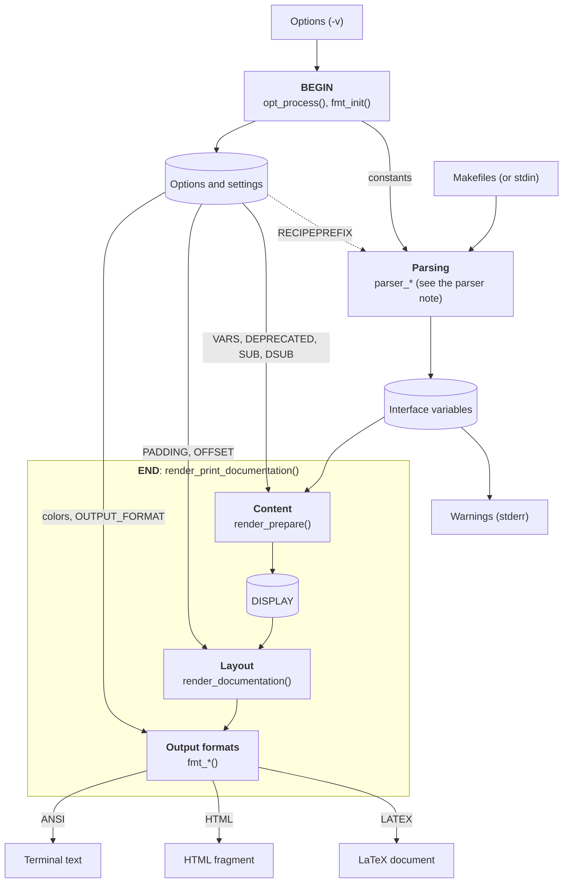

# Tests

`makefile-doc.awk` is checked in three ways:

- **integration tests** run the script on small Makefiles and compare its output with the expected
  one;
- **unit tests** call selected functions of the script in isolation;
- **lint** runs the integration and unit tests under `gawk --lint` and fails on unexpected warnings.

We want the script to support the main awk implementations. The integration and unit tests therefore
run on a chosen _platform_ — an awk variant and the environment where it runs. It can be the `awk`
installed on the host machine, a version built from source, or the awk a Linux distribution ships,
run in a container (see [Platforms](#platforms)).

Everything is run by [pytest](https://docs.pytest.org) through [uv](https://docs.astral.sh/uv). The
root `Makefile` has the following shortcuts:

```sh
make test                      # run integration and unit tests with the system's awk
make test PLATFORM=host-mawk   # ... with another awk (`make platforms` lists them)
make lint                      # gawk --lint (and ruff on the Python code)
make check                     # lint, then test
```

## Integration tests

An integration test (a _case_) runs `makefile-doc.awk` on a Makefile and compares its output with
the expected one. We refer to such input Makefiles as _fixtures_ (`test/fixtures/Makefile.*`), and
each case is a file `test/integration/<name>.test` with the following format:

```
#: desc: what this case checks (the expected behavior)
#: issue: 123
-v COLOR=0 -v SUB='...' test/fixtures/Makefile.sub
#: stderr
<expected stderr>
#: stdout
<expected stdout>
#: exit: 1
```

- The `#:` lines at the top are metadata. `desc` is required. `issue` links the case to an issue,
  `bug` marks a known bug (see [Known bugs](#known-bugs)), `env` sets an environment variable
  for the run, and `stdin` gives a file whose content is the stdin of awk (otherwise, stdin is
  empty). `trace` loads `tools/trace-state.awk` before the script: the expected stdout is then
  the state of the parser after each line of the fixture (see the tool) instead of the help.
  `timeout` sets the time limit of the run in seconds (30 by default): a case that checks that
  the script stays fast fails when awk takes longer.
- The next line holds the awk arguments, in shell syntax.
- The rest is the expected output: stderr after `#: stderr`, stdout after `#: stdout`, and `#: exit:
  N` when the exit status is not zero.

In `help.test`, the version of the script is written `@VERSION@`, so that a release does not change
the expected output.

By convention, a fixture covers one small topic, its cases are named `<topic>.test` or
`<topic>-<variation>.test` after `Makefile.<topic>` (`<topic>-trace.test` for its trace), and
colors are off (`-v COLOR=0`) unless the case is about colors or output formats.

Integration tests are run with `uv run pytest test/test_integration.py --platform <name>` (the
default platform is `host-awk`). `test_case` (in `test/test_integration.py`) is parametrized with
the cases (one per `.test` file) and the platforms. The reference output can be updated by passing
`--update` to pytest (instead of writing it by hand)[^1].

## Unit tests

awk has no unit-test framework, and `makefile-doc.awk` is meant to be run, not imported — it
processes options, parses the Makefiles and prints their documentation. To test its functions one by
one, we load the script as a library, call its functions from a test file, and report the results
with a small harness that acts as the test framework.

This relies on two properties of awk:

- All the files given with `-f` are combined into **one program**. They share their
  functions and global variables, and their `BEGIN` blocks run in the order of the files.
  After that the rules process the input, and finally the `END` blocks run.
- An `exit` in a `BEGIN` block **jumps to the `END` blocks**, skipping the remaining `BEGIN` code
  and all the rules.

A unit test file runs as follows (`test/test_unit.py`):

```
awk -v UNIT_TEST=1 -v STDERR=<file> \
    -f test/unit/harness.awk -f makefile-doc.awk -f test/unit/test_helpers.awk /dev/null
```

which results in the following program:

```
# --- -v assignments: done before anything else runs ---
UNIT_TEST = 1
STDERR    = "/path/to/file"

# ===== 1. test/unit/harness.awk =====
...                                    # check(), check_true(), check_bug(), stderr_text()
function done() {
  ...
  exit (HARNESS_FAILED > 0 ? 1 : 0)
}
BEGIN {                                # BEGIN #1 (initialize harness state)
  HARNESS_N = 0
  ...
}

# ===== 2. makefile-doc.awk =====
...                                    # library functions, incl. init_globals()
BEGIN {                                # BEGIN #2
  init_globals()                       # initialize global state
  if (!UNIT_TEST) {
    if (opt_process() > 0) {           # skipped
      ABORT = 1
      exit 1
    }
    parser_init(RECIPEPREFIX, PARSER_STATE, PARSER_MEMORY)   # skipped
  }
}
...                                    # rules that parse a Makefile (never run)
END {
  ...
  if (!UNIT_TEST) {
    ...
    render_print_documentation()       # skipped
  }
}

# ===== 3. test/unit/test_helpers.awk =====
...                                    # test functions, which call check()
BEGIN {                                # BEGIN #3
  test_max_min()
  test_text_length()
  ...
  done()                               # prints the number of checks, then exit
}

# --- input: /dev/null ---
```

`UNIT_TEST` is what turns `makefile-doc.awk` into a library: its `BEGIN` block only initializes the
global state (needed for the unit tests), without processing options, and the content of its `END`
block is skipped.

The three `BEGIN` blocks run in order: the harness resets its counters, the script initializes its
global state, and the test file calls the library functions and checks their results. A test file
has no `END` block: it ends its `BEGIN` block with `done()`, which prints the number of checks and
calls `exit`. awk then jumps to the `END` block of the script, which does nothing, so the rules that
parse a Makefile never run and awk exits with the status of `done()` (1 if a check failed).

Each test file runs in its own awk process, because an `exit` ends the whole program, not just one
test file. If all the test files were to run in one process, an `exit` from any of them would
silently skip the following tests.

### Writing a unit test

A test file looks like this:

```awk
function test_string_replace() {
  check("string_replace: plain", string_replace("a", "X", "banana"), "bXnXnX")
  check_true("max: larger first", max(2, 1) == 2)
}

BEGIN {
  test_string_replace()
  done()
}
```

A test that changes the global state can call `init_globals()` to reset it.

`STDERR` sends the messages of the script to a file instead of `/dev/stderr`. A test reads them with
`stderr_text()`, typically to check them, e.g., `check("bad option", stderr_text(),
"makefile-doc: error: ...\n")`. A message left unread fails the test file, so that no error or warning goes unnoticed.

The output of the harness is in [TAP](https://testanything.org) format, a plain-text format with one
line per check, ending with the number of checks:

```
ok 1 - string_replace: plain
not ok 2 - max: larger first
#   got:  "1"
#   want: "2"
1..2
```

As with integration tests, unit tests are parametrized with the test files and the platforms.
`test_unit` (in `test/test_unit.py`) runs a test file, reads its TAP output, and reports each check
as a pytest subtest.

## Known bugs

Registering a bug goes through three steps:

1. **Issue.** Every bug has a GitHub issue.
2. **Reproducer.** A test written by hand with the _correct_ expected result: a case with a
   `#: bug: N` line, or a `check_bug(name, got, want, N)` call next to the other checks of the same
   function. Reproducers run with the other tests and are expected to fail (pytest reports them as
   `xfailed`), so a reproducer can be merged before a fix exists.
3. **Fix.** Once the bug is fixed, its reproducer passes, and that makes the tests fail
   (`XPASS(strict)` for a case, `FIXED` for a check) until it is turned into a regular test:
   `#: bug: N` becomes `#: issue: N`, and `check_bug` becomes `check`.

Bugs of awk implementations that the script works around are not part of this process: each one has
a reproducer in `misc/`, referenced by the comment at the workaround (e.g.,
`misc/busybox_awk_bug_20251107.awk`).

## Lint

`gawk --lint` only warns about code that actually runs, and without input almost none of
`makefile-doc.awk` runs. `test/test_lint.py` therefore runs every integration case and unit test
file with `gawk --lint`, and checks warnings located in `makefile-doc.awk`.

Some warnings are harmless, e.g., an option that is not passed with `-v` is read without being set,
which gawk reports as `reference to uninitialized variable ...`. We declare such warnings as
expected in one of two ways:

- `ignore` in the `[tool.makefile-doc.lint]` section of `pyproject.toml`: regular expressions that
  match warnings on any line;
- a `# lint: ignore[TEXT]` comment: matches a warning containing `TEXT` at a specific line:

  ```awk
  last = substr(text, length(text), 1) # lint: ignore[substr: start index]
  ```

Any other warning fails the tests. If an exception no longer matches any warning (e.g., the
code it was written for has changed), the tests fail too, so that the exception is removed.

### Global variables

In awk, a variable that is not a function parameter is global. A local variable is
therefore declared as an extra parameter (`function f(a,    local)`), and a forgotten
declaration silently creates a global. Two tests in `test/test_lint.py` catch this, using
the list of global variables that `gawk -d` dumps:

- `test_global_names`: verifies that the global variables of `makefile-doc.awk` are named in
  `UPPER_CASE`;
- `test_unit_file_defines_no_globals`: verifies that a unit test file defines no global variables of
  its own.

## Platforms

A _platform_ is an environment (the host machine or a container) together with an awk variant and
its flags (e.g., `gawk --posix`). The platforms are defined as tables of `test/containers.toml`. For
example:

```toml
[host-gawk-posix]
host = true
awk = "gawk --posix"

[host-mawk2020]
host = true
build = "test/containers/mawk.Containerfile"
args = { VERSION = "t20200120", SHA256 = "..." }
awk = "test/bin/mawk2020"

[debian12]
image = "debian:12"
awk = "mawk"
```

+ `host-gawk-posix` runs the tests with `gawk --posix` on the host machine (`gawk` is assumed to be
  installed).

+ `host-mawk2020` runs the tests with `mawk 1.3.4-20200120` on the host machine, from
  `test/bin/mawk2020`. The binary is built in a container from the Containerfile (`build`) with the
  build arguments (`args`), then copied out of the image to `test/bin/mawk2020`. It is statically
  linked, so it runs on any Linux.

  Before the tests run, a stamp file next to the binary (`test/bin/.mawk2020.image`) ensures that
  `test/bin/mawk2020` exists and is up to date. The stamp holds the name of the image the binary
  came from, which includes a hash of the Containerfile and `args`. If the binary is missing, or if
  the Containerfile or `args` have changed, the binary is built and copied again.

+ `debian12` runs the tests with the `mawk` of the `debian:12` image, as Debian packages it. The
  tests themselves run on the host machine, and only `mawk` runs in the container: the container is
  started once, and each `mawk` call is an `exec` in it. If an image does not include the awk, the
  `install` key can provide a shell command that installs it.

A table can inherit the keys of another table with `extends`, and any key it sets itself overrides
the inherited one. `ci = true` also runs the platform in CI, and `explicit = true` runs it only when
named explicitly (a pattern such as `'*'` does not select it). `crlf = true` is for an awk that writes
`\r\n`, as native Windows awks do: the tests compare its output with `\n`. `ansi_args = true` is for
an awk that gets its arguments in the ANSI code page rather than in UTF-8, as a native Windows gawk
does: the cases with non-ASCII arguments are skipped.

Building binaries and running containers need a container engine: `podman` by default, or another
one set with `--engine` (`ENGINE=` with make), e.g., `--engine docker`.

On every platform, awk runs with only `LC_ALL=C`, the `#: env:` variables of a case, and `PATH`
(fixed in containers, inherited on the host machine). The tests select platforms with `--platform`
(a name or a pattern, e.g., `host-*`). The code is in `test/platforms.py`: `Platform.run` prepares a
platform and yields an `Awk`, which the `awk` pytest fixture gives to the tests.

# Architecture

`makefile-doc.awk` runs in three steps, which follow how awk runs a script: `BEGIN` initializes the
global variables and processes the options, the parsing reads the Makefiles one line at a time, and
`END` renders the documentation.



Parsing reads no option except `RECIPEPREFIX`, the recipe prefix at the start. A Makefile is
therefore always parsed the same way, whatever the display options, and gives the same interface
variables. Rendering then runs in two stages: `render_prepare` decides what is displayed (which
anchors, under which names, with which docs and sections) and writes the `DISPLAY` records, and the
layout prints them in the output format. The output goes to stdout in all three formats.

[^1]: `--update` takes one platform only and never rewrites a known-bug case.
